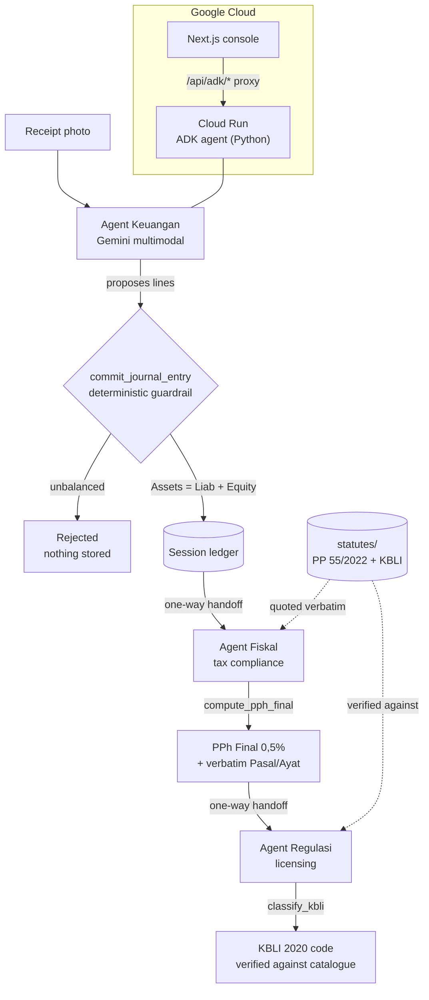

# Nata

**Runs your business admin while you sleep.**  
*Photo a receipt, talk to a bot, or let your AI staff handle the rest. Autonomous bookkeeping, 0.5% MSME tax defense, and verified licensing — convenience first, statutory compliance under the hood.*

Nata is an autonomous 24/7 business suite for Indonesian MSMEs (warung, kafe, retail, online shops), built for the **Google Cloud AI Builder Cup 2026**. Instead of expensive payroll or late-night spreadsheet dread, owners get a dedicated digital back-office team that keeps books balanced and legal filings bank-ready.

Our multi-agent autonomous team:

| Bot Staff | Role & Everyday Outcome | Compliance Power Under the Hood |
| --- | --- | --- |
| 🤖 **Akuntan Pribadi** (`Agent Keuangan`) | Reads receipts & invoices in seconds. Posts balanced ledgers without manual math. | Guaranteed **SAK EMKM** standard compliance; mathematical zero-delta guardrail (`Assets = Liab + Equity`). |
| 🏛️ **Konsultan Pajak** (`Agent Fiskal`) | Automates monthly tax set-asides and protects your Rp 500M personal exemption. | **PP 55/2022** statutory calculator with verbatim article citations. |
| 🛡️ **Spesialis Legal** (`Agent Regulasi`) | Turns plain-language business descriptions into verified NIB permits. | Maps against official **KBLI 2020** 1,790-code catalog under OSS RBA. |
| ✨ **Manajer Keuangan** (`Orchestrator`) | Coordinates the bots behind the scenes so the owner gets peace of mind. | Atomic handoffs between agents, preventing hallucinated or orphan transactions. |

This is a Python [ADK](https://google.github.io/adk-docs/) project with a Canva-simple Next.js console. Gemini multimodal parses raw documents; deterministic Python tools enforce strict accounting integrity, tax arithmetic, and regulatory verification.

> **Branching:** this repo uses a lite git flow (`main` / `develop` /
> `feature/*`). See [AGENTS.md](./AGENTS.md) before making changes.

## Architecture



**The model proposes, the code enforces.** `commit_journal_entry` never trusts
the LLM: it re-validates the posting and raises on any violation. The tax
agent likewise never does its own arithmetic and never invents a citation —
`compute_pph_final` recomputes everything and attaches quotes that are checked
verbatim against the in-repo statute text. And `classify_kbli` refuses any code
that is not in the catalogue, so a hallucinated KBLI cannot reach the UI.

Grounding is **in-repo and in-context**, by deliberate choice: the statute text
and the KBLI catalogue ship with the code, so no managed RAG index can surface
a wrong or paraphrased passage. See
[`docs/regulasi-provenance.md`](./docs/regulasi-provenance.md) for the source
and verification status of every legal dataset.

**Entity type decides the tax.** The business form is a first-class field, not
a label: under PP 55/2022 Pasal 60 ayat (2) the Rp 500 million zero-tax band
applies to *orang pribadi* only — PT Perorangan and PT/CV are taxed from the
first rupiah. `nata_agent/entities.py` encodes that, and the tax engine takes
the entity rather than a coarse yes/no flag.

## Prerequisites

1. **Python 3.12** via [`uv`](https://docs.astral.sh/uv/) (system `python3` is
   3.9 — too old). `uv` will provision 3.12 automatically.
2. **Google Cloud Application Default Credentials (ADC)** authorised for
   project `nata-hackathon`:
   ```bash
   gcloud auth application-default login
   ```
   No API keys live in code — ADK/Gemini authenticate via ADC.

## Run it (3 steps)

```bash
# 1. Install dependencies into .venv (Python 3.12)
uv sync

# 2. Configure env — copy the template and keep it OUT of git
cp .env.example .env    # .env is gitignored; never commit real values

# 3. Launch the ADK dev UI from the repo root
uv run adk web --port 48702   # open http://localhost:48702, pick "nata_agent"
```

`adk api_server` serves every agent package in the repo, so both apps appear in
the picker:

| App | What it is |
| --- | --- |
| `nata_agent` | The cascade entry point — Agent Keuangan, which hands off to Fiskal and on to Regulasi |
| `nata_regulasi` | Agent Regulasi on its own, so a screen can call `classify_kbli` directly |

CLI instead of a browser (either app):

```bash
uv run adk run nata_agent       # the whole cascade
uv run adk run nata_regulasi    # licensing only
```

`adk web` is the framework's dev harness (a generic chat playground). The
product UI is the Next.js console in [`web/`](./web) — Indonesian, light mode,
written for shop owners: **Dasbor**, **Catat Struk** (receipt OCR), **Transaksi**,
**Daftar Akun**, **Laporan Keuangan** (SAK EMKM statements), **Pajak**
(PPh Final UMKM), **Perizinan** (KBLI 2020), plus **Profil Usaha** and
**Pengaturan**. It talks to the same agent API; run `adk api_server --port 48700`
behind it.

Ports are a reserved, high/uncommon namespace so they never collide with other
dev servers on the same machine:

| Port | Service |
| --- | --- |
| `48700` | ADK `api_server` (backend the console proxies to) |
| `48701` | Next.js console |
| `48702` | `adk web` dev playground |

See [`web/README.md`](./web/README.md) for the information architecture, the
accounting model, and how to run it.

## Tests

```bash
uv run pytest
```

## Repo layout

```
.
├── pyproject.toml            # uv-managed; pins adk + google-genai + pydantic
├── .env.example              # placeholder env (no secrets)
├── Makefile                  # dev tasks: make dev / check / down
├── README.md
├── docs/
│   └── regulasi-provenance.md  # source + verification status of legal data
├── nata_agent/               # the cascade entry point
│   ├── __init__.py           # exports root_agent
│   ├── agent.py              # the three agents + instructions
│   ├── tax.py                # Agent Fiskal's engine + Pasal citations
│   ├── regulasi.py           # Agent Regulasi: KBLI catalogue + verify guardrail
│   ├── entities.py           # business forms and their tax treatment
│   └── statutes/             # grounded corpora (shipped, not retrieved)
│       ├── pp-55-2022-pph-final-umkm.md
│       └── kbli/kbli-2020-5digit.json   # 1,790 codes + hierarchy
├── nata_regulasi/            # Agent Regulasi as its own ADK app
│   └── __init__.py           # re-exports the one definition (see docs)
├── tests/
│   ├── test_commit_journal_entry.py
│   ├── test_compute_pph_final.py
│   ├── test_entities.py      # entity → tax treatment
│   ├── test_regulasi.py      # verify-not-invent guardrail
│   ├── test_kbli_quality.py  # classification quality floor
│   └── test_cascade.py       # cascade topology
└── web/                      # Next.js console (see web/README.md)
    └── src/
```

## Environment variables

See `.env.example`. All values are placeholders; secrets are never committed.

| Variable | Purpose |
| --- | --- |
| `GOOGLE_CLOUD_PROJECT` | GCP project (`nata-hackathon`) |
| `GOOGLE_CLOUD_LOCATION` | Vertex AI endpoint for Gemini. Gemini is served **only** on `global` for this project (`asia-southeast2` returns `400 FAILED_PRECONDITION`). Use `asia-southeast2` for regional services (Cloud Run, Firestore). |
| `GOOGLE_GENAI_USE_ENTERPRISE` | Route Gemini through Google Cloud / Vertex AI (ADK 2.x name for the old `GOOGLE_GENAI_USE_VERTEXAI`) |
| `NATA_MODEL` *(optional)* | Gemini model id; default `gemini-3.8-flash` (e.g. `gemini-4-argon` for deeper reasoning) |

## Roadmap

All three agents are implemented and verified: Agent Keuangan, Agent Fiskal
and Agent Regulasi. Next: a production deploy to Cloud Run / Firebase,
staying live through the judging window (19 Oct – 6 Nov).

Two things are deliberately **not** done, and are flagged rather than hidden:

- **`statutes/kbli/` re-sourcing.** The KBLI catalogue was taken from a public
  GitHub mirror that carries no licence. The codes are factual government data
  (KBLI 2020, BPS), but the extraction path needs replacing with an official
  source before public distribution.
- **PP 20/2026.** Research notes claim it amends PP 55/2022 (permanent 0.5%
  rate, PT/CV excluded). It could not be verified from a primary source, so it
  is **not** encoded; the engine follows the in-repo PP 55/2022.

See [`docs/regulasi-provenance.md`](./docs/regulasi-provenance.md).

## Contributing

This repository uses a lite git flow — `main` for releases, `develop` for
integration, and short-lived `feature/*` / `fix/*` / `hotfix/*` branches.
The full workflow, commit-message convention, and pre-commit checks are in
[AGENTS.md](./AGENTS.md).

```bash
uv run pytest                        # Python: agent + tax engine
git switch develop && git switch -c feature/<slice>
```

## Licence

**Apache-2.0** — see [`LICENSE`](./LICENSE). The licence covers the source code
in this repository.

It does **not** relicense the third-party material included for functionality.
[`NOTICE`](./NOTICE) sets out the scope precisely:

| Item | Status |
| --- | --- |
| Application source (Python + Next.js) | Apache-2.0 |
| KBLI 2020 codes and titles (`statutes/kbli/`) | Factual government data, BPS — not relicensed here |
| PP 55/2022 statute text (`statutes/`) | Publicly promulgated legislation — cited, not claimed |

See [`docs/regulasi-provenance.md`](./docs/regulasi-provenance.md) for the source
and verification status of each dataset.
